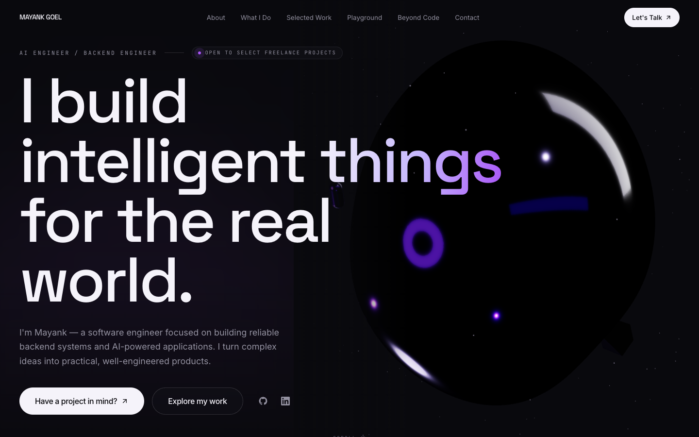
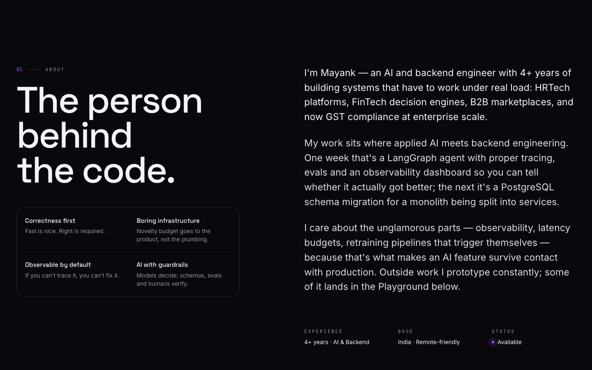
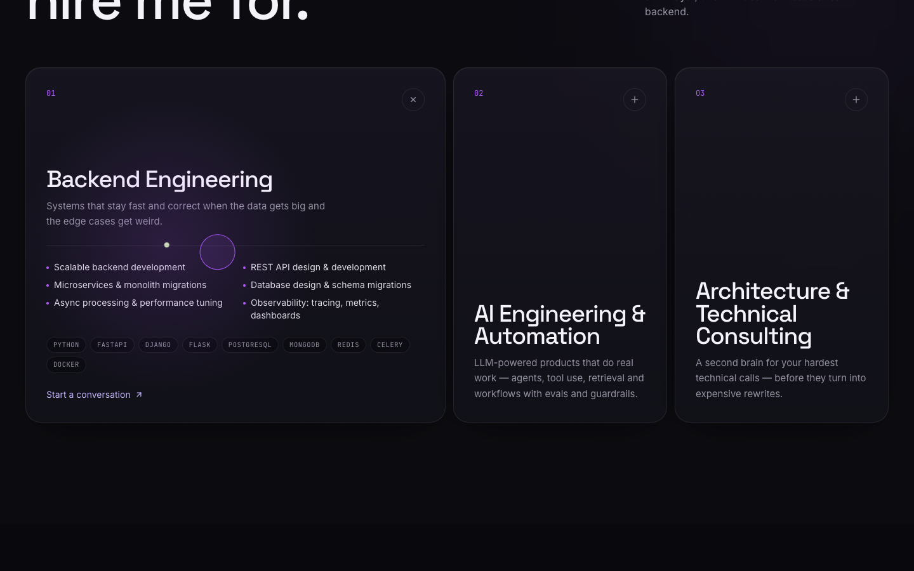
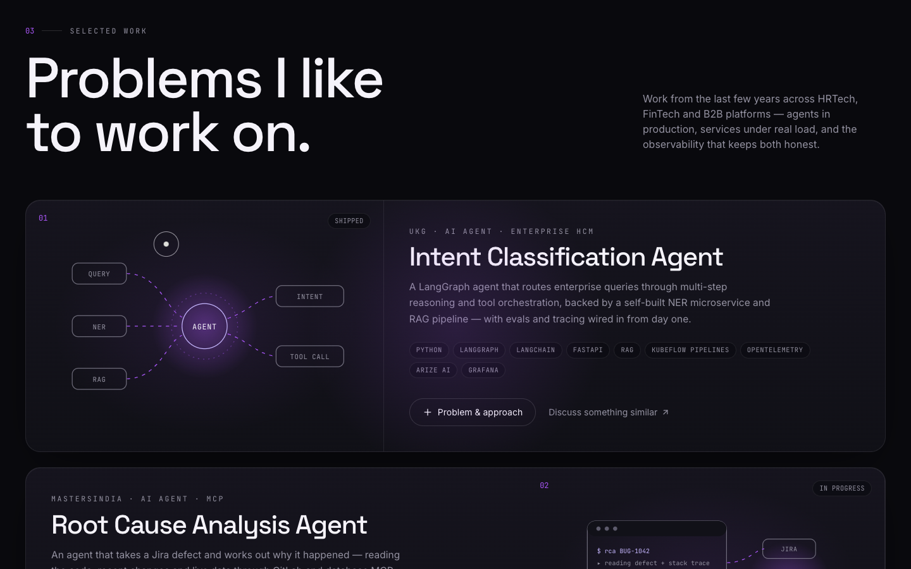
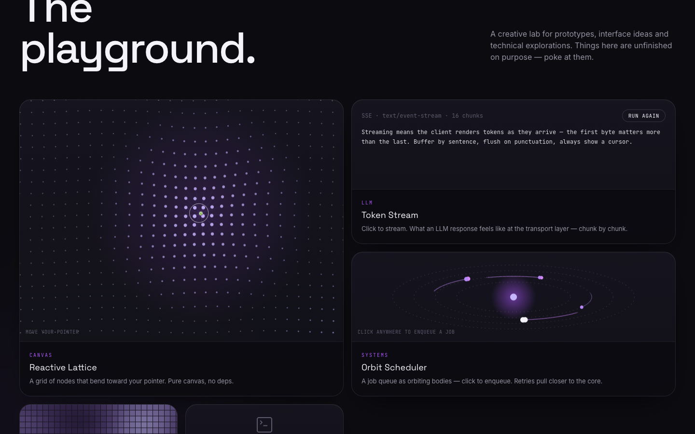
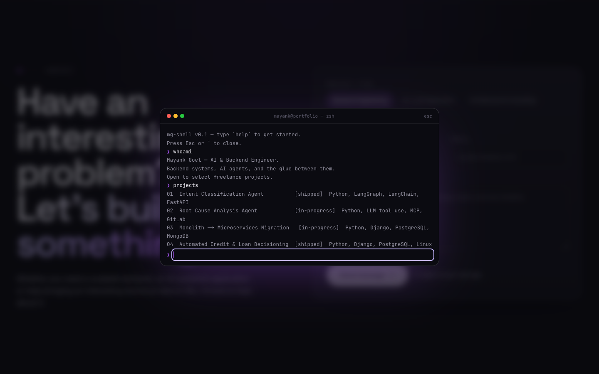
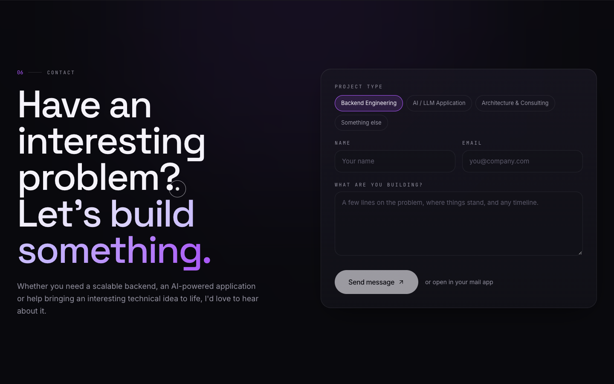
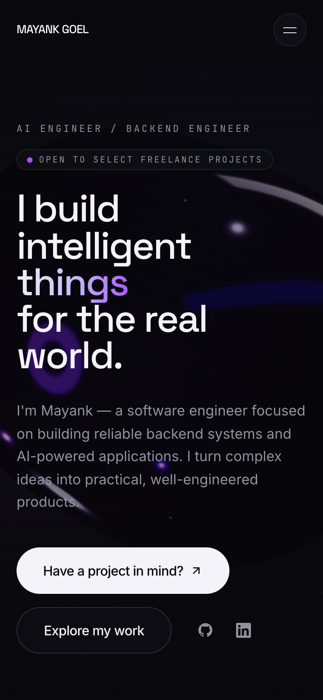
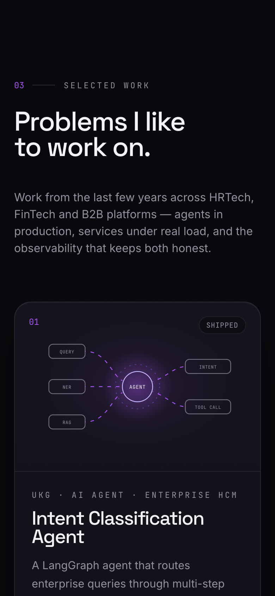

<div align="center">

# Mayank Goel — Portfolio

**AI & Backend Engineer.** I build intelligent things for the real world.

[**Live site →**](https://mayankgoel.vercel.app) &nbsp;·&nbsp; [LinkedIn](https://www.linkedin.com/in/mayank-goel-724932174/) &nbsp;·&nbsp; [Email](mailto:mayankgoyal662@gmail.com)




</div>

---

## What's inside

A dark, motion-heavy personal site that stays fast and accessible:

- **Liquid-metal 3D hero.** A React Three Fiber scene that follows your pointer, with lighter settings on mobile and a static gradient when WebGL isn't available.
- **Hidden terminal.** Press <kbd>`</kbd> anywhere and try `help`, `whoami`, `projects`, `experience`, `skills`, `open work`.
- **Playground of live experiments.** Canvas demos you can poke: a lattice that bends to your pointer, an LLM token stream, a job-queue orbit, a rippling noise field.
- **Project cards with architecture diagrams.** Hand-drawn SVG diagrams per project, each card expanding into problem and approach.
- **Smooth scroll, custom cursor, magnetic buttons, text reveals.** All of it switches off under `prefers-reduced-motion`.
- **A contact form that never dead-ends.** It sends via Resend when configured and falls back to a pre-filled `mailto:` when not.

## Screenshots

| About | What I do |
| --- | --- |
|  |  |
| **Selected work** | **Playground** |
|  |  |
| **Terminal easter egg** | **Contact** |
|  |  |

<p align="center">
  
  &nbsp;&nbsp;
  
</p>

## Tech stack

| Area | Tools |
| --- | --- |
| Framework | **Next.js 16** (App Router), **React 19**, **TypeScript 6** |
| Styling | **Tailwind CSS v4** (design tokens in `globals.css`), `next/font` (Space Grotesk, Inter, JetBrains Mono) |
| Motion | **Motion** (Framer Motion), **Lenis** smooth scroll, Canvas 2D for the playground |
| 3D | **Three.js**, **React Three Fiber**, **drei** |
| Icons | Lucide React, inline SVG |
| Backend | Next.js Route Handler (`POST /api/contact`), Resend REST API |
| SEO | Metadata API, JSON-LD (`Person`), generated Open Graph image, `sitemap.xml`, `robots.txt` |
| Quality | ESLint 9 (`eslint-config-next`, React Compiler hook rules), `tsc --noEmit` |
| Hosting | Vercel (Hobby) |

No CMS, database, UI kit or analytics. The home page is pre-rendered static HTML on the CDN; the only server code is the contact endpoint.

## Run locally

```bash
npm install
npm run dev          # http://localhost:3000
npm run build && npm start
npm run lint
npm run typecheck
```

Requires Node 20+.

## Project structure

```
src/
├─ app/                 layout, page, API route, OG image, sitemap, robots
├─ components/
│  ├─ hero/             Hero + R3F scene
│  ├─ sections/         About, Services, Work, Playground, Beyond, Contact, Diagram
│  ├─ playground/       canvas demos
│  ├─ terminal/         the ` terminal
│  ├─ layout/           Nav, Footer
│  ├─ providers/        Lenis smooth scroll
│  └─ ui/               Cursor, Loader, Reveal, Magnetic, Button, Icons
├─ content/             ← all copy lives here
└─ lib/                 hooks, scroll lock, utils
```

## Editing content

All copy lives in `src/content/`, so the usual changes never touch a component:

| File | Controls |
| --- | --- |
| `site.ts` | name, title, links, availability, nav, stack marquee |
| `about.ts` | intro, principles, timeline, education, recognition, skills |
| `services.ts` | "What I do" cards |
| `projects.ts` | Selected work cards and their diagrams |
| `experiments.ts` | Playground tiles |
| `beyond.ts` | "Beyond the terminal" photos and captions |

## Contact form

`POST /api/contact` validates input, drops bots via a honeypot field, rate-limits per IP (5 per 10 minutes per instance), and sends through [Resend](https://resend.com) when `RESEND_API_KEY` is set. Without a key it returns `503` and the client opens a pre-filled `mailto:` instead.

Copy `.env.example` to `.env.local`:

| Variable | Required | Notes |
| --- | --- | --- |
| `RESEND_API_KEY` | no | Enables email delivery; without it the form uses mailto |
| `CONTACT_TO_EMAIL` | no | Inbox for enquiries |
| `CONTACT_FROM_EMAIL` | no | Verified sender; `onboarding@resend.dev` works for testing |
| `NEXT_PUBLIC_SITE_URL` | no | Only for a custom domain; on Vercel the production URL is detected automatically |

Secrets go in Vercel's environment variables, never in the repo.

## Accessibility & performance

- `prefers-reduced-motion` turns off smooth scroll, the loader, the cursor, parallax and canvas loops.
- The custom cursor mounts only on fine pointers; touch devices keep native behaviour.
- Canvas demos pause when off-screen; the 3D scene loads client-side only and drops resolution on mobile.
- Keyboard: skip link, visible focus rings, <kbd>Esc</kbd> closes the menu and terminal.

## Deploy

Push to GitHub, import the repo on [Vercel](https://vercel.com/new) and deploy; it needs no other configuration. Every push to `main` redeploys automatically.

---

© Mayank Goel. The code is here to read and learn from; the personal content (copy, photos, project write-ups) isn't for reuse.
